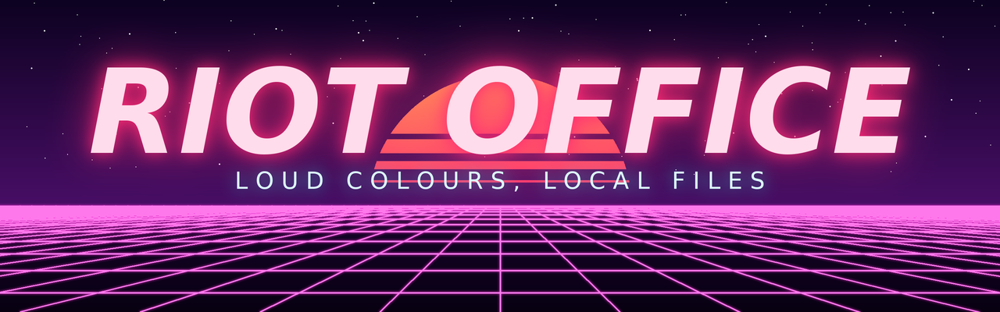

<p align="center">
  
</p>

<h1 align="center"> RIOT OFFICE</h1>

<p align="center">
  <em>ｌｏｕｄ　ｃｏｌｏｕｒｓ，　ｌｏｃａｌ　ｆｉｌｅｓ</em> — a desktop office suite that lives on your PC, built on LibreOffice.<br>
  <a href="https://github.com/battles5/riot-office/releases/latest"><strong>Download for Windows or Ubuntu</strong></a>
  ·
  <a href="docs/EXCEL-FUNCTIONS.md">Excel functions</a>
  ·
  <a href="docs/COMPATIBILITY.md">Compatibility</a>
  ·
  <a href="docs/Guide.html">User guide</a>
  ·
  <a href="docs/ROADMAP.md">Roadmap</a>
  ·
  <a href="CHANGELOG.md">Changelog</a>
</p>

<p align="center">
  
  
  
  
  
  
  
</p>

---

Riot Office is what office software used to be: you install it, it runs on your computer, your
files stay on your disk. No account, no cloud, no subscription.

It is built on **LibreOffice**, but it is not LibreOffice as it comes. The aim is a suite that feels
and works like the Word, Excel, PowerPoint and Acrobat people already know, so moving over is not a
step down. This page says plainly what Riot Office adds, what is still to come, and what cannot be
done.

| You know | In Riot Office | |
|---|---|---|
| Word | **Riot Writer** | LibreOffice Writer, set up like Word |
| Excel | **Riot Calc** | LibreOffice Calc, plus the Excel functions it lacks |
| PowerPoint | **Riot Impress** | LibreOffice Impress, set up like PowerPoint |
| Acrobat | **Riot PDF** | PDF tools today; a full editor is planned |

## What Riot Office adds

✅ in this release · 🛠 planned, see the [roadmap](docs/ROADMAP.md) · ❌ not possible, or not worth promising

### Excel

| | |
|---|---|
| ✅ **`GROUPBY`, `PIVOTBY`, `PERCENTOF`** | Excel 365's grouping and cross-table functions, which Calc does not have. Aggregation by name (`"SUM"`, `"SOMMA"`, `"SUM,AVERAGE"`), totals, sorting, filters |
| ✅ **`REGEXTEST`, `REGEXEXTRACT`, `REGEXREPLACE`** | Excel's regular-expression functions, with Excel's arguments, on single cells or whole ranges |
| ✅ **Inventory of your workbooks** | Finds macros, Power Query, data models, slicers and the functions Calc lacks, across a whole share, without opening a file |
| 🛠 **A Power Query-like tool** | Import, transform and refresh data (CSV, Excel, ODS, databases) from a dialog |
| 🛠 **`.xlsx` round trip for the Riot functions** | Today a formula using them is kept as values in `.xlsx`; see below |
| ❌ **Power Pivot / DAX, slicers** | Too large to promise |

> **Read before relying on it.** The Riot functions work when typed in Calc and are saved in `.ods`.
> In `.xlsx` they are written under an internal name that Excel does not know, and they show
> `#NAME?` when the file is reopened; the values stay. Details and the remaining differences from
> Excel are in [docs/EXCEL-FUNCTIONS.md](docs/EXCEL-FUNCTIONS.md).

### Word, Excel, PowerPoint: the Office feel

| | |
|---|---|
| ✅ **Saves as `.docx` / `.xlsx` / `.pptx` by default** | And never asks "keep current format?" |
| ✅ **Tabbed, ribbon-like interface** | On by default in Writer, Calc and Impress |
| ✅ **Documents keep their pages** | Carlito and Caladea (metric-compatible with Calibri and Cambria) on both systems; Aptos falls back to Carlito |
| ✅ **English and Italian everywhere** | Launcher, setup, menu entries, LibreOffice's interface and help; one switch changes them together |
| ✅ **Quiet by default** | No update check, no crash report upload, no tip-of-the-day; only trusted macros run |
| ✅ **Fidelity check** | Compare how LibreOffice renders your documents with PDFs exported from Microsoft Office: page count and text similarity, file by file |
| 🛠 **Riot theme** | Icons, colours and start screen of its own, in the same spirit as the launcher |
| 🛠 **Word / Excel keyboard shortcuts and menus** | Where LibreOffice's defaults differ |
| 🛠 **Templates** | Letter, report, budget, slide deck, in English and Italian |
| ❌ **A pixel-for-pixel copy of Office's look** | Their icons and trade dress are not ours to copy |
| ❌ **Full VBA** | Excel macros partly run; Word and PowerPoint macros do not |

### Acrobat

| | |
|---|---|
| ✅ **Merge, split, rotate** | From the launcher or `riot-office pdf` |
| ✅ **Documents to PDF, and PDF/A-2b** | Archive-ready, from any file Riot Office opens |
| ✅ **OCR** | Makes scans searchable (with OCRmyPDF and Tesseract installed) |
| 🛠 **Riot PDF editor** | Viewer, annotations, text editing, forms, redaction, compare — built on PDF4QT |
| 🛠 **Italian digital signatures** | Smart cards (CNS and qualified providers), PAdES and CAdES `.p7m`, verification against the EU trusted lists |
| ❌ **Acrobat-grade paragraph reflow, PDF to Word, dynamic XFA forms** | They will stay behind Acrobat for a long time |

## Why "riot"?

- **A riot of colour.** Neon pink, cyan and yellow over a striped sunset: office software does not
  have to be grey.
- **A quiet riot against lock-in.** Your documents, your disk, open formats underneath. Nothing is
  uploaded, nothing expires, nothing needs a licence server.
- **Do it yourself.** Like a punk record, it is made from parts anyone can get: free software,
  assembled and tuned, with new parts where something was missing.

## Requirements

|  | Windows | Ubuntu |
|---|---|---|
| System | Windows 10/11 64-bit (x64) | Ubuntu 24.04 or 26.04 (Debian 12+ works too) |
| Rights | administrator (LibreOffice installs per machine) | `sudo` |
| Disk | about 1.2 GB | about 600 MB with dependencies |
| Internet | not needed: the setup contains everything | only to download packages from the Ubuntu archive |

## Installation

### Windows

1. Download `RiotOffice-Setup-<version>.exe` from the
   [Releases](https://github.com/battles5/riot-office/releases/latest).
2. Run it. The setup is not digitally signed yet: if Windows shows "Windows protected your PC",
   choose *More info* → *Run anyway*.
3. Pick English or Italian and follow the wizard. It installs LibreOffice (skipped when the same
   version is already there), the fonts, the Riot configuration, the Excel functions and the launcher.

The Start menu gets *Riot Office*, *Riot Writer*, *Riot Calc*, *Riot Impress* and the guide.
`.docx`, `.xlsx`, `.pptx` and the older Office formats open with LibreOffice.

Silent install for IT departments:

```
RiotOffice-Setup-0.1.0.exe /VERYSILENT /SUPPRESSMSGBOXES /NORESTART /LANG=it
```

### Ubuntu

```bash
sudo apt install ./riot-office_0.1.0_all.deb
```

`apt` pulls LibreOffice, the Italian language pack, the fonts and the dictionaries from Ubuntu's
archive, so they keep getting Ubuntu's security updates, and registers the Excel functions. Ubuntu
24.04 ships an older LibreOffice (24.2); for 26.8 add the LibreOffice PPA first:

```bash
sudo add-apt-repository ppa:libreoffice/ppa
```

## Usage

Open **Riot Office** from the menu: pick Writer, Calc or Impress, or a PDF tool. The *Language*
menu switches between English and Italian (LibreOffice follows at its next start).

The same tools on the command line:

```bash
riot-office doctor                                   # is everything in place?
riot-office open calc budget.xlsx                    # open a file
riot-office convert *.docx --to pdf --pdfa           # PDF/A-2b for archiving
riot-office pdf merge all.pdf a.pdf b.pdf            # merge, split, rotate, ocr
riot-office inventory //server/share --out inventory.md --csv inventory.csv
riot-office fidelity corpus/ office-pdfs/ --out fidelity.md
riot-office addin install                            # the Excel functions, if they are missing
riot-office language it                              # Italian everywhere
```

On Windows the command is `"C:\Program Files\Riot Office\runtime\python.exe" -m riot_office`.

## How it is built

```
riot_office/       launcher (Tk), command line, LibreOffice helpers, PDF tools, inventory, fidelity,
                   excel_functions.py (the logic of GROUPBY, PIVOTBY, REGEX*, in plain Python)
addins/calc/       the Calc extension: IDL interface, Python component, names in English and Italian
config/            riot-office*.xcd: the LibreOffice configuration layers (common + one per module)
installer/         Windows setup (Inno Setup + PowerShell) and Ubuntu .deb, pinned downloads
assets/            artwork and the script that draws it
docs/              guide, Excel functions, compatibility matrix, roadmap, strategy
ci/                checks run by GitHub Actions on real installs
```

Run from source (Python 3.10+, LibreOffice installed):

```bash
python -m pip install -e .[dev]
python -m pytest
python -m riot_office
```

Build the installers: `bash installer/linux/build_deb.sh` on Linux,
`installer\windows\build_installer.ps1` on Windows (needs Inno Setup 6). Package the Excel functions
alone with `python addins/calc/build_oxt.py`. Redraw the artwork with `python assets/make_art.py`.

The [strategy](docs/STRATEGY.md) explains the choices: why LibreOffice is distributed, configured
and extended rather than forked, and why the PDF editor will be built on PDF4QT.

## Licence

Riot Office's own files are under **MIT No Attribution** ([LICENSE.txt](LICENSE.txt)).
LibreOffice (MPL-2.0), the fonts (SIL OFL 1.1), Python and pypdf keep their own licences: see
[THIRD-PARTY-NOTICES](installer/THIRD-PARTY-NOTICES.txt).

Riot Office is an independent distribution *based on LibreOffice*. It is not affiliated with or
endorsed by The Document Foundation, Microsoft or Adobe; their product names are used only to
describe file compatibility.
